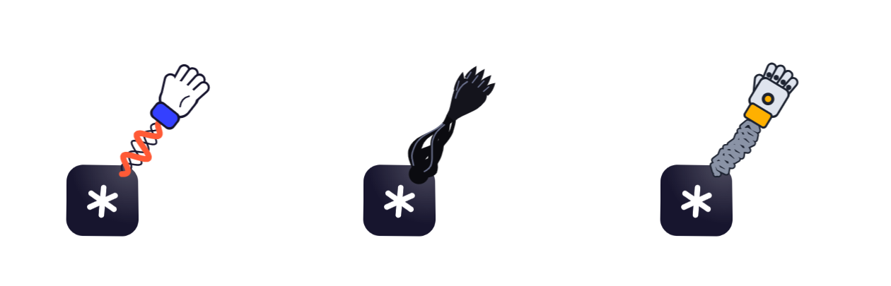

# reach-button

A button that turns into your logo and reaches for the cursor.



- **Near:** the button leans in 3D, folds into your logo, and an arm comes out. It waves, reaches, and beckons if you stop.
- **Touching:** the hand grips the cursor and shakes.
- **On the button:** the logo opens back into your label, with a thumbs-up.

The clickable area never moves and the label is always there when it's time to click. No dependencies, and it works on buttons you already have.

## Quick start

No JavaScript to write:

```html
<a href="/contact" data-reach data-reach-preset="goo" data-reach-logo="/logo.svg">Contact us</a>

<script type="module" src="https://cdn.jsdelivr.net/gh/oldSheldon/reach-button@0.1.0/src/auto.js"></script>
```

Or from code:

```html
<script type="module">
  import { reach } from "https://cdn.jsdelivr.net/gh/oldSheldon/reach-button@0.1.0/src/reach-button.js";

  reach(".cta", {
    preset: "paper",
    logo: "/logo.svg",
    armColor: "#ff5a36",
  });
</script>
```

Or install it from GitHub:

```sh
npm install github:oldSheldon/reach-button
```

```js
import { reach } from "reach-button";
```

## Make it yours

Open `index.html` through a local web server (for example `npx serve`) for a playground: pick a look, change colours, try your logo, and copy the code.

| Option | Default | What it does |
|---|---|---|
| `preset` | `"paper"` | `"paper"`, `"goo"` or `"robot"`. Everything else overrides it. |
| `logo` | a plain mark | SVG markup, an image URL, or an Element |
| `logoSize` | `0` | Pixels. `0` picks a size from the button's height |
| `badgeColor` | `"button"` | Behind the logo: `"button"`, `"none"`, or any colour |
| `badgeRadius` | `16` | Corner radius of that badge |
| `arm` | from preset | `"squiggle"`, `"goo"` or `"spring"` |
| `hand` | from preset | `"paper"`, `"claw"` or `"robot"` |
| `armColor` `handColor` `inkColor` `cuffColor` `shineColor` | from preset | Any CSS colour |
| `ring` | `190` | How close the cursor must be before the arm comes out |
| `morphAt` | `138` | How close before it turns into the logo |
| `reach` | `168` | How far the hand stretches |
| `handSize` `thickness` | `1.18` `1` | Size of the hand and arm |
| `tilt` | `15` | Degrees of 3D lean. `0` turns it off |
| `morph` `wave` `beckon` `shake` `thumbsUp` `greet` | `true` | Turn any behaviour off |
| `zIndex` | `2147483000` | Stacking order of the arm |
| `onChange` | none | Called with `"near"`, `"touch"`, `"over"` or `"away"`, and the element |
| `drawArm` `drawHand` | none | Draw your own on the canvas |

With `auto.js`, write options as attributes: `data-reach-arm-color="#0af"`, `data-reach-thumbs-up="false"`.

`reach()` returns `{ update(options), destroy() }`.

### Draw your own hand

```js
reach(".cta", {
  // Wrist at 0,0, fingers towards +x. curl and thumb run from 0 to 1.
  drawHand(ctx, { curl, options }) {
    ctx.fillStyle = options.handColor;
    ctx.beginPath();
    ctx.arc(14, 0, 14 - curl * 4, 0, Math.PI * 2);
    ctx.fill();
  },
});
```

### React

```jsx
import { useEffect, useRef } from "react";
import { reach } from "reach-button";

export function ReachLink({ children, options, ...props }) {
  const ref = useRef(null);
  useEffect(() => {
    const handle = reach(ref.current, options);
    return () => handle.destroy();
  }, []); // pass a stable options object, or call handle.update()
  return <a ref={ref} {...props}>{children}</a>;
}
```

## Good to know

- **Accessibility:** visitors who prefer reduced motion get your normal button. The extra layers are hidden from screen readers, and keyboard focus is untouched.
- **Manners:** the arm stays in while the cursor is on another link, button or field, or while a dialog is open.
- **Touch screens:** each button says hello once, when it's first seen.
- **Performance:** one canvas for the whole page. Nothing runs until the cursor is close.
- **Styling:** it copies your button's background, border, radius and shadow. Buttons that draw their background with `::before` or `::after` won't fold fully.
- **Logos:** SVG markup you pass is inserted as HTML, so only use markup you trust.
- **Browsers:** current Chrome, Edge, Safari and Firefox (it needs CSS `color-mix` and canvas `roundRect`). Tested in Chrome so far.

## Licence

[MIT](LICENSE). Use it, change it, ship it, including commercially.

Use your own logo. This licence covers the code, not anyone's brand.
